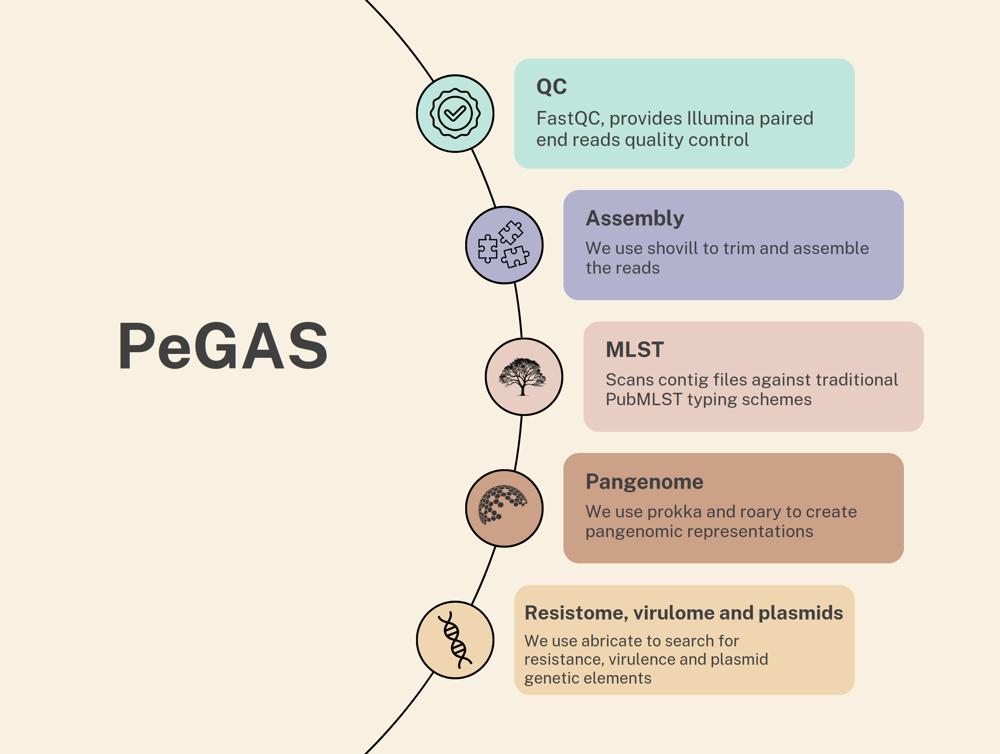
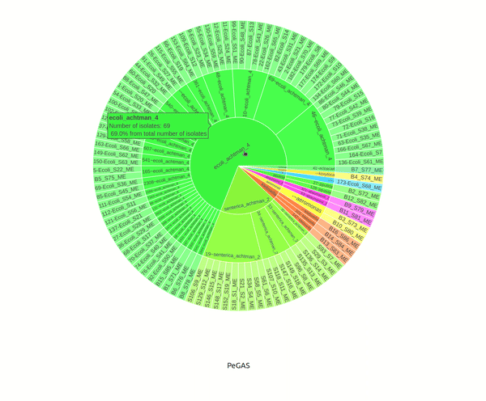

# PeGAS: A Comprehensive Bioinformatic Solution for Pathogenic Bacterial Genomic Analysis

This is PeGAS, a bioinformatic tool designed for seamless QC, assembly, and annotation of Illumina paired-end reads from pathogenic bacteria. It integrates widely used open-source tools to deliver reproducible genomic analysis and reporting.

## Key Features

- **Quality Control:** FastQC-based QC for Illumina paired-end reads.
- **Assembly:** De novo assembly using SPAdes (via Shovill).
- **AMR:** AMRFinderPlus for acquired resistance genes and **resistance point mutations** (e.g. gyrA/parC, when the MLST species is supported).
- **Virulence and plasmids:** Abricate with VFDB and PlasmidFinder.
- **Typing and QC:** MLST, QUAST, CheckM2, with a PASS/WARN/FAIL verdict per assembly.
- **Pangenome:** Prokka + Roary per species (samples without an assigned species are never pooled).
- **Reports:** Clean, static R HTML report by default, with an optional interactive HTML report.
- **GUI:** Launch a simple GUI to configure runs without remembering CLI flags.
- **Parallel execution:** Multi-core execution across pipeline steps, with per-tool core controls.





## How to Use

### 1. Prerequisites

- **Conda** (Miniforge or Miniconda recommended)

To check your conda install:

```bash
(base)user@user:~$ conda info
```

If you **don't have conda yet installed**, we recommend Miniforge: https://conda-forge.org/download/

### 2. pegas vs pegas-lite

- **pegas:** Best for **many samples** and **high-throughput** runs, with **more RAM** and **disk space** available. Uses **Snakemake** with per-tool conda environments.
- **pegas-lite:** Best for **fewer samples** and **limited RAM/disk space**. Runs the same tools directly without Snakemake.

PeGAS does not install every bioinformatics tool into one large environment because several tools have conflicting dependency requirements. Instead, the command checks the required tool environments when it starts, creates any missing or stale environments, and then runs the analysis.

- `pegas` creates Snakemake conda environments inside the output folder under `.snakemake/conda`.
- `pegas-lite` creates reusable tool environments under `~/.pegas/envs`.
- Bundled Linux lock/pin files are used when they match the platform; otherwise PeGAS falls back to the bundled environment YAML files.
- The first run may spend time creating environments. Later runs reuse them when the specs still match.

### 3. Installing pegas (Snakemake)

`mamba` is recommended for faster conda solving, but the PeGAS package itself is installed with conda:

```bash
(base)user@user:~$ conda install conda-forge::mamba
```

```bash
(base)user@user:~$ conda create -n pegas -c bioconda -c conda-forge pegas
(base)user@user:~$ conda activate pegas
```

### 4. Installing pegas-lite (no Snakemake)

```bash
(base)user@user:~$ conda create -n pegas-lite -c bioconda pegas-lite
```

This creates a new environment called `pegas-lite` and installs the package from `bioconda`. Activate it with:

```bash
(base)user@user:~$ conda activate pegas-lite
```

### 5. Running from the CLI

- Put your paired reads in a folder (separate from the install path), or list them in a samplesheet.
- Check what PeGAS detected before spending hours of compute:

```bash
pegas -d /path/to/fastqs -o /path/to/output --dry-run
```

- Then run it:

```bash
pegas -d /path/to/fastqs -o /path/to/output --cores 16
```

**Input naming.** Files ending in `.fastq.gz`, `.fq.gz`, `.fastq` or `.fq` are paired by their mate token, for example `S1_R1.fastq.gz`/`S1_R2.fastq.gz`, `S1_L001_R1_001.fastq.gz` or `SRR123_1.fq.gz`/`SRR123_2.fq.gz`. Files without a recognisable mate, and samples missing R1 or R2, are listed as warnings and left out. For any other naming, use a samplesheet (CSV or TSV; relative paths are resolved against the samplesheet's folder):

```text
sample,r1,r2
isolate_A,reads/A_forward.fq.gz,reads/A_reverse.fq.gz
```

```bash
pegas --samplesheet samples.csv -o /path/to/output
```

**Re-running and resuming.** Running again with the same `-o` resumes the previous run and only computes what is missing (for example after a crash or after adding samples). `--overwrite` deletes the previous results and starts over. PeGAS refuses to write into a non-empty folder that is not a PeGAS output folder.

Full usage (same for `pegas-lite`):

```bash
usage: pegas [-h] [-d DATA] [--samplesheet SAMPLESHEET] -o OUTPUT [-c CORES]
             [--overwrite] [--dry-run] [--shovill-cpu-cores SHOVILL_CPU_CORES]
             [--shovill-ram SHOVILL_RAM] [--prokka-cpu-cores PROKKA_CPU_CORES]
             [--amrfinder-cpu-cores AMRFINDER_CPU_CORES]
             [--quast-cpu-cores QUAST_CPU_CORES]
             [--checkm2-cpu-cores CHECKM2_CPU_CORES]
             [--roary-cpu-cores ROARY_CPU_CORES]
             [--on-tool-failure {stop,warn}] [--interactive]

options:
  -d DATA, --data DATA  Directory with paired FASTQ files (.fastq.gz, .fq.gz,
                        .fastq, .fq)
  --samplesheet SAMPLESHEET
                        CSV/TSV with columns sample,r1,r2 (alternative to
                        --data)
  -o OUTPUT, --output OUTPUT
                        Directory for outputs
  -c CORES, --cores CORES
                        Total cores to use (default: all)
  --overwrite           Delete the previous results in the output directory
                        and start over (without it, an existing PeGAS output
                        directory is resumed)
  --dry-run             Show detected samples and planned resources, then exit
  --shovill-cpu-cores, --shovill-ram (GB), --prokka-cpu-cores,
  --amrfinder-cpu-cores, --quast-cpu-cores, --checkm2-cpu-cores,
  --roary-cpu-cores     Per-tool resources (sensible defaults are derived
                        from --cores and the machine's RAM)
  --on-tool-failure {stop,warn}
                        Stop on tool failures, or warn and continue with
                        explicit failed/skipped sample status.
  --interactive         Generate the interactive HTML report (optional)
```

**Requirements and databases.**

- RAM: Shovill (SPAdes) is the most demanding step; 16 GB is comfortable for typical bacterial genomes, and PeGAS sizes Shovill jobs to the available RAM.
- Disk: plan roughly 1 to 2 GB per sample for intermediate files, plus about 5 GB for the per-tool conda environments.
- Databases are downloaded once on first use and shared between runs: AMRFinderPlus (~250 MB) in `~/.pegas/amrfinder_db` (override with `AMRFINDER_DB_DIR`) and CheckM2 (~3 GB) in `~/.pegas/checkm2_db` (override with `CHECKM2_DB_DIR`, or point `CHECKM2DB` at an existing `.dmnd` file). Offline machines should pre-populate these folders.

### 6. Reports and GUI

- **Default report:** `report/report_r.html`, a single self-contained HTML file you can email. It opens with an overview (QC verdicts, which samples carry acquired AMR genes, point mutations, virulence genes and plasmids), followed by the resistome (acquired genes and point mutations side by side), virulome, plasmids, MLST, QC, pangenome and run details.
- **Interactive report (optional):** add `--interactive` to also generate the older Plotly/Jinja report at `report/report.html`.
- **GUI:** run `pegas` or `pegas-lite` with no arguments to launch the GUI. It covers the common CLI flags; pick an existing output folder to resume it.

### 7. Visualising the results

When a run finishes, PeGAS prints a short summary: how many samples passed QC, which samples need attention and why, and where the report is. Then look at:

- `report/report_r.html`: main static report.
- `dataframe/pegas_results.xlsx`: one workbook with sample status, assembly QC and the presence/absence matrices.
- `dataframe/assembly_qc.tsv`: per-sample species, ST, QUAST/CheckM2 metrics and the `QC_STATUS` (PASS/WARN/FAIL) with `QC_NOTES`. FAIL: completeness < 80%, contamination > 10%, N50 < 5 kb or more than 1000 contigs. WARN: completeness < 90%, contamination > 5%, N50 < 20 kb, more than 500 contigs, GC more than 2 points from the species' expected value, or no species assigned.
- `dataframe/amr_matrix.tsv`, `virulence_matrix.tsv`, `plasmid_matrix.tsv`: sample x gene presence/absence (point mutations appear as e.g. `gyrA_S83L`).
- `dataframe/results.csv`: every hit, one row each (`PREDICTION_SOURCE` is `AMR`, `VFDB`, `PlasmidFinder`, `Stress` or `AMRFinder_virulence`; `ELEMENT_SUBTYPE` is `POINT` for point mutations).
- `dataframe/sample_status.tsv`: per-sample status of every step.
- `dataframe/database_versions.tsv` and `pegas_config.json`: database and tool versions and run parameters.
- `logs/<step>/<sample>.log` and `benchmarks/<step>/<sample>.tsv` (`pegas`) or `results/<sample>/status/*.log` (`pegas-lite`): tool logs and per-step runtime/memory.
- `results/`: per-sample tool outputs.

Samples whose MLST scheme is unknown are labelled `Unassigned`; they are analysed individually but never grouped into a pangenome.

### PeGAS works out of the box on Linux systems. For Windows and macOS, we recommend using virtualization software like Docker or WSL.

### 8. Citation

Liviu-Iulian Rotaru, Marius Surleac, PeGAS: a versatile bioinformatics pipeline for antimicrobial resistance, virulence and pangenome analysis, Bioinformatics Advances, Volume 5, Issue 1, 2025, vbaf165, https://doi.org/10.1093/bioadv/vbaf165
