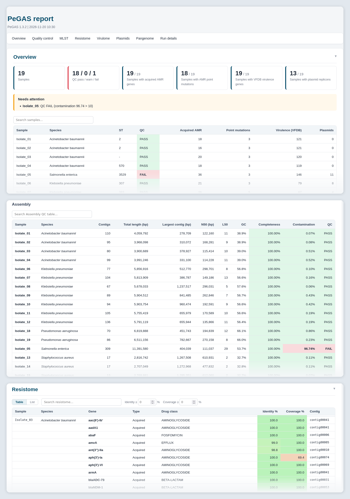

# PeGAS

PeGAS takes Illumina paired-end reads from bacterial isolates and runs read QC, assembly,
assembly QC, MLST, resistance, virulence and plasmid screening, annotation and a per-species
pangenome. The results are collected in a single self-contained HTML report.

PeGAS is installed with conda. The analysis tools live in their own conda environments, which
PeGAS creates on the first run, with the same tool versions on Linux and macOS.



A run of 19 isolates (*A. baumannii*, *K. pneumoniae*, *S. aureus*, *P. aeruginosa* and one
*S. enterica*), with sample names anonymized. From top to bottom: the overview with QC verdicts
and gene counts per sample; the assembly QC table, where the *S. enterica* sample fails on
contamination (CheckM2 contamination 96.7%, typical of a mixed culture); and the resistome table,
with identity and coverage coloured from red to green.

## Contents

- [What it does](#what-it-does)
- [Installation](#installation)
- [Running PeGAS](#running-pegas)
- [The report](#the-report)
- [Outputs](#outputs)
- [QC verdicts](#qc-verdicts)
- [All options](#all-options)
- [Tools and versions](#tools-and-versions)
- [Citation](#citation)
- [License](#license)

## What it does

For every sample, PeGAS runs:

1. Read QC with FastQC.
2. Trimming and assembly with Shovill, which trims adapters and low-quality bases with
   Trimmomatic and assembles the reads with SPAdes.
3. Assembly QC with QUAST and CheckM2, ending in a PASS, WARN or FAIL verdict
   (see [QC verdicts](#qc-verdicts)).
4. MLST, with the scheme detected automatically. The species comes from the matching scheme;
   there is no separate species identification step.
5. Resistance screening with AMRFinderPlus: acquired genes, and point mutations (for example in
   *gyrA* or *parC*) when AMRFinderPlus has a model for the species.
6. Virulence and plasmid screening with Abricate, using VFDB and PlasmidFinder.
7. Annotation with Prokka.

For each species with at least two samples, it then builds a pangenome with Roary.

Samples without an MLST call are labelled `Unassigned` (or `Unknown` if MLST failed). They go
through all the per-sample steps, but are not included in any pangenome, and AMRFinderPlus
cannot look for point mutations without a species.

## Installation

You need conda. If you don't have it yet, install [Miniforge](https://conda-forge.org/download/).

PeGAS runs on Linux (x86_64) and macOS. On Apple Silicon Macs the tools run through Rosetta 2;
install it once with `softwareupdate --install-rosetta`. On Windows, install Ubuntu through WSL
(Windows Subsystem for Linux) and run PeGAS inside it.

Assembly is the heaviest step: 16 GB of RAM is enough for typical bacterial genomes, and PeGAS
checks how much RAM the machine has and limits the assemblies to fit. Plan about 1 to 2 GB of
disk per sample for intermediate files, plus about 8 GB for the tools and databases.

There are two commands, which run the same tools and give the same results:

- `pegas` uses the Snakemake workflow manager to run steps from different samples at the same
  time. It is the better fit for large batches.
- `pegas-lite` runs the same steps without Snakemake and has fewer dependencies.

If you're not sure, install `pegas`; it includes `pegas-lite` as well:

```bash
conda create -n pegas -c conda-forge -c bioconda pegas
conda activate pegas
```

To install only the lite version, replace `pegas` with `pegas-lite` in both lines, and type
`pegas-lite` instead of `pegas` in all the commands below. Run `conda activate pegas` each time
you open a new terminal, before using PeGAS.

The first run creates the tool environments in `~/.pegas/envs` and downloads the AMRFinderPlus
database (about 250 MB) and the CheckM2 database (about 3 GB). Both commands use the same copy.
To do this in advance and check that every tool starts:

```bash
pegas --setup
```

It prints `ok` or `FAIL` for each tool. If the machine will later work offline, run it once
while it is still online.

## Running PeGAS

Put the paired reads in a folder, then check what PeGAS finds there:

```bash
pegas -d /path/to/reads -o /path/to/output --dry-run
```

This lists the samples and the two files paired for each, warns about any file or sample it
left out, and shows the cores each tool will get and the RAM for assembly. Then start the run:

```bash
pegas -d /path/to/reads -o /path/to/output
```

PeGAS uses all CPU cores by default; add for example `--cores 8` if you share the machine. For
`-o`, give a new or empty folder, or an earlier PeGAS output folder to resume it. PeGAS refuses
a folder that already holds other files.

When the run ends, PeGAS prints how many samples passed QC, which ones need attention and why,
and a link that opens the report.

**Without the command line.** Running `pegas` or `pegas-lite` with no arguments opens a small
window with the common options. Pick an existing output folder there to resume it.

**File names.** Files ending in `.fastq.gz`, `.fq.gz`, `.fastq` or `.fq` are paired by their read
number, so `S1_R1.fastq.gz` and `S1_R2.fastq.gz`, `S1_L001_R1_001.fastq.gz`, or `SRR123_1.fq.gz`
and `SRR123_2.fq.gz` are all recognised. Files without a read number, and samples missing R1 or
R2, are listed as warnings and left out. Samples whose read files are empty are left out too.
For any other naming, use a samplesheet (CSV or TSV; relative paths are read from the
samplesheet's folder):

```text
sample,r1,r2
isolate_A,reads/A_forward.fq.gz,reads/A_reverse.fq.gz
```

```bash
pegas --samplesheet samples.csv -o /path/to/output
```

**Resuming.** Running the same command again picks up where the last run stopped and computes
only what is missing, for example after a crash or after you copy new read files into the reads
folder. Results of samples that are no longer in the input are removed. `--overwrite` deletes
all previous results and starts from scratch.

**Failed samples.** If a tool fails on one sample, that sample is marked as failed (in the report
and in `dataframe/sample_status.tsv`) and the run continues for the others. With
`--on-tool-failure stop`, the whole run stops at the first failure instead.

## The report

The report is `report/report_r.html`, one file with everything embedded. Its sections:

- Overview: sample count, QC pass/warn/fail counts, the samples that need attention, and one row
  per sample with species, ST, QC verdict and the number of AMR genes, point mutations,
  virulence genes and plasmid replicons.
- Quality control: FastQC read counts and GC (next to the GC expected for the species), the
  QUAST and CheckM2 table with verdicts, and plots by species.
- MLST: species and sequence type per sample.
- Resistome, Virulome, Plasmids: every hit with its identity, coverage and contig. You can switch
  between a table and a compact list, search, and set a minimum identity and coverage. Identity
  is coloured from red (90% or less) to green (100%), coverage from red (60% or less) to green.
- Pangenome: a gene presence/absence heatmap for each species.
- Run details: the status of every step for every sample, and the tool and database versions.

Add `--interactive` to also build the older interactive Plotly report at `report/report.html`.

## Outputs

Main files in the output folder:

- `report/report_r.html`: the report.
- `dataframe/pegas_results.xlsx`: sample status, assembly QC and the presence/absence matrices
  in one workbook.
- `dataframe/assembly_qc.tsv`: species, ST, QUAST and CheckM2 metrics, `QC_STATUS` and
  `QC_NOTES` for each sample.
- `dataframe/amr_matrix.tsv`, `virulence_matrix.tsv`, `plasmid_matrix.tsv`: one row per sample
  and one column per gene, marking each gene present or absent. Point mutations appear as genes,
  for example `gyrA_S83L`.
- `dataframe/results.csv`: every hit, one per row. `PREDICTION_SOURCE` is `AMR`, `VFDB`,
  `PlasmidFinder`, `Stress` or `AMRFinder_virulence` (the last two are the stress response and
  virulence genes AMRFinderPlus reports), and `ELEMENT_SUBTYPE` is `POINT` for point mutations.
- `dataframe/sample_status.tsv`: the status of each step for each sample.
- `dataframe/database_versions.tsv` and `pegas_config.json`: database versions and run settings.
- `results/<sample>/`: the output of each tool.
- Tool logs: in `logs/` for `pegas` (with the time and memory of each step in `benchmarks/`),
  and in `results/<sample>/status/` for `pegas-lite`.

## QC verdicts

Each assembly gets a verdict from its QUAST and CheckM2 numbers:

- FAIL: no assembly, completeness below 80%, contamination above 10%, N50 below 5 kb, or more
  than 1000 contigs.
- WARN: completeness below 90%, contamination above 5%, N50 below 20 kb, more than 500 contigs,
  GC more than 2 percentage points away from the value expected for the species, or no species
  assigned.
- PASS: none of the above.

The reason is in `QC_NOTES`, and in the report it appears when you hover over the verdict. High
contamination together with an assembly about twice the expected size usually means a mixed
culture.

## All options

`pegas-lite` takes the same options.

```text
usage: pegas [-h] [-d DATA] [--samplesheet SAMPLESHEET] [-o OUTPUT] [-c CORES]
             [--overwrite] [--dry-run] [--setup] [--shovill-cpu-cores SHOVILL_CPU_CORES]
             [--shovill-ram SHOVILL_RAM] [--prokka-cpu-cores PROKKA_CPU_CORES]
             [--amrfinder-cpu-cores AMRFINDER_CPU_CORES]
             [--quast-cpu-cores QUAST_CPU_CORES]
             [--checkm2-cpu-cores CHECKM2_CPU_CORES]
             [--roary-cpu-cores ROARY_CPU_CORES]
             [--on-tool-failure {stop,warn}] [--interactive]

options:
  -d DATA, --data DATA  Directory with paired FASTQ files (.fastq.gz, .fq.gz,
                        .fastq, .fq)
  --samplesheet SAMPLESHEET
                        CSV/TSV with columns sample,r1,r2 (alternative to
                        --data)
  -o OUTPUT, --output OUTPUT
                        Directory for outputs
  -c CORES, --cores CORES
                        Total cores to use (default: all)
  --overwrite           Delete the previous results in the output directory
                        and start over (without it, an existing PeGAS output
                        directory is resumed)
  --dry-run             Show detected samples and planned resources, then exit
  --setup               Create the tool environments, download the databases
                        and check every tool starts, then exit (no input
                        needed)
  --shovill-cpu-cores, --shovill-ram (GB), --prokka-cpu-cores,
  --amrfinder-cpu-cores, --quast-cpu-cores, --checkm2-cpu-cores,
  --roary-cpu-cores     Per-tool resources (defaults are derived from --cores
                        and the machine's RAM)
  --on-tool-failure {stop,warn}
                        warn (default): mark the failed sample and finish
                        the run for all other samples; stop: stop the whole
                        run at the first tool failure.
  --interactive         Generate the interactive HTML report (optional)
```

The databases are kept in `~/.pegas/amrfinder_db` and `~/.pegas/checkm2_db` and shared between
runs. To use another location, set `AMRFINDER_DB_DIR` or `CHECKM2_DB_DIR` before running
PeGAS, for example `export CHECKM2_DB_DIR=/data/checkm2_db`. To use a CheckM2 database you
already have, point `CHECKM2DB` at its `.dmnd` file.

## Tools and versions

The versions are fixed in [`src/pegas/envs/`](src/pegas/envs/) and are the same on Linux and
macOS.

| Step                | Tools |
| ------------------- | ----- |
| Read QC             | FastQC 0.12.1 |
| Assembly            | Shovill 1.4.2 with SPAdes 3.15.5 and Trimmomatic 0.40 |
| Assembly QC         | QUAST 5.3.0, CheckM2 1.1.0 |
| Typing              | mlst 2.33.1 (PubMLST schemes) |
| Resistance          | AMRFinderPlus 4.2.7 (`--plus`, point mutations with `--organism` from the MLST species) |
| Virulence, plasmids | Abricate 1.4.0 with VFDB and PlasmidFinder (80% identity and 80% coverage) |
| Annotation          | Prokka 1.15.6 |
| Pangenome           | Roary 3.13.0 |
| Report              | R 4.3 with rmarkdown, pandoc |

## Citation

If you use PeGAS, please cite:

Liviu-Iulian Rotaru, Marius Surleac. PeGAS: a versatile bioinformatics pipeline for
antimicrobial resistance, virulence and pangenome analysis. *Bioinformatics Advances*, 5(1),
2025, vbaf165. https://doi.org/10.1093/bioadv/vbaf165

Please also cite the tools listed in [Tools and versions](#tools-and-versions) and the databases
they use (AMRFinderPlus, VFDB, PlasmidFinder, PubMLST, CheckM2), which have their own citations
and licenses.

## License

PeGAS is free software under the GNU General Public License, version 2 or later. See
[`LICENSE`](LICENSE).
